<p align="center"></p>
<h1 align="center">SEMbada</h1>
<p align="center"><b>PLS-SEM portabel untuk semua orang.</b><br>
Dari data kuesioner ke hasil model pengukuran dan struktural, gambar siap terbit, hingga draf naskah, semuanya di komputer Anda sendiri.</p>

<p align="center">
<a href="https://novrisuhermi-sem.share.connect.posit.cloud"><b>Buka aplikasi</b></a> &nbsp;·&nbsp;
<a href="app/SEMbada_PLS-SEM.html">Aplikasi portabel (satu file HTML)</a> &nbsp;·&nbsp;
<a href="https://github.com/novrisuhermi/sembada/releases">Versi Windows dan macOS</a> &nbsp;·&nbsp;
<a href="README.md">English</a>
</p>

<p align="center">


</p>

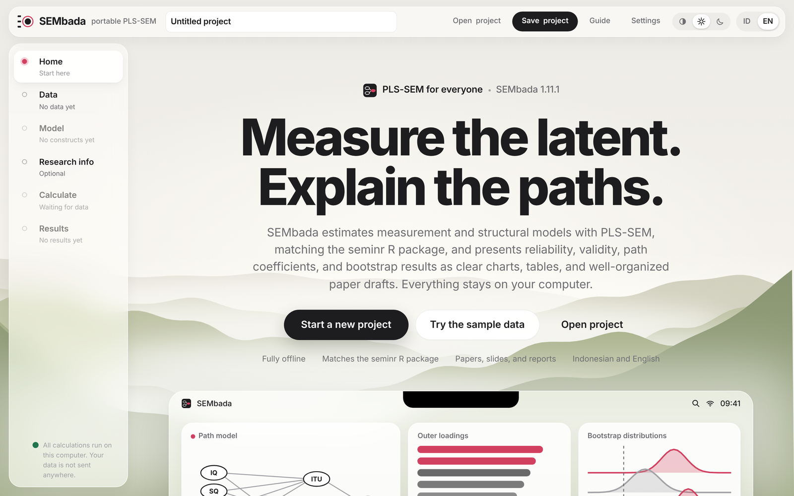

**SEMbada** mengestimasi model persamaan struktural *partial least squares* (PLS-SEM) dari data survei dan menjelaskan setiap hasil dengan bahasa yang mudah dipahami. Aplikasi ini ditulis dalam JavaScript dan berjalan sebagai satu file HTML, di browser maupun sebagai aplikasi desktop, tanpa instalasi, tanpa R, dan tanpa mengunggah data Anda. Hasil estimasinya sudah dicocokkan dengan paket R **seminr**, dan setiap analisis disertai kode R yang setara untuk replikasi mandiri.

## Daftar isi

- [Kemampuan](#kemampuan)
- [Mulai cepat](#mulai-cepat)
- [Alur kerja](#alur-kerja)
- [Model](#model)
- [Estimasi](#estimasi)
- [Evaluasi model pengukuran](#evaluasi-model-pengukuran)
- [Evaluasi model struktural](#evaluasi-model-struktural)
- [Analisis lanjutan](#analisis-lanjutan)
- [Gambar dan diagram jalur](#gambar-dan-diagram-jalur)
- [Ekspor](#ekspor)
- [Validasi terhadap R](#validasi-terhadap-r)
- [Dataset contoh](#dataset-contoh)
- [Privasi](#privasi)
- [Struktur repositori dan membangun dari sumber](#struktur-repositori-dan-membangun-dari-sumber)
- [Sitasi](#sitasi)
- [Referensi](#referensi)
- [Perangkat lunak pihak ketiga dan lisensi](#perangkat-lunak-pihak-ketiga-dan-lisensi)

## Kemampuan

| Bagian | Yang disediakan SEMbada |
|---|---|
| Data | Impor Excel (.xlsx) atau CSV, kode data hilang yang bisa ditentukan sendiri, *mean replacement* atau penghapusan responden tidak lengkap, statistik deskriptif, sebaran jawaban, uji validitas dan reliabilitas butir klasik |
| Model | Penyusun model jalur seret-dan-lepas; konstruk reflektif (Mode A) dan formatif (Mode B); pengelompokan indikator otomatis berdasarkan nama; 12 model siap pakai beserta datanya (DeLone & McLean, TAM, UTAUT2, TPB, SERVQUAL, ACSI/ECSI, reputasi perusahaan, dan lainnya) |
| Estimasi | PLS-SEM dengan skema pembobotan *path*, *factorial*, atau *centroid*; PLS konsisten (PLSc) |
| Inferensi | Bootstrapping hingga 10.000 subsampel, interval persentil atau BCa, uji satu atau dua arah |
| Model pengukuran | Loading dan weight, Cronbach's α, ρ<sub>A</sub>, ρ<sub>C</sub>, AVE, Fornell–Larcker, HTMT dengan interval bootstrap, cross loading, VIF indikator |
| Model struktural | Koefisien jalur, R², R² terkoreksi, f², VIF antarkonstruk, efek tidak langsung spesifik dan efek total, SRMR, PLSpredict (Q²<sub>predict</sub>, RMSE, MAE terhadap pembanding regresi linear) |
| Lanjutan | Moderasi (dua tahap), konstruk orde tinggi (dua tahap terpisah), analisis multigrup dengan MICOM dan uji permutasi, peta kepentingan–kinerja (IPMA), ukuran sampel minimum (metode *inverse square root*) |
| Keluaran | Laporan Word, makalah dua kolom gaya konferensi (Word, LaTeX, PDF), slide PowerPoint dan Beamer, tabel Excel, ZIP gambar (PNG dan SVG), file proyek, kode R yang setara untuk seminr |
| Antarmuka | Bahasa Indonesia dan Inggris (bahasa dokumen bisa berbeda dari bahasa antarmuka), tema terang dan gelap, desktop, tablet, dan ponsel |

## Mulai cepat

1. **Buka SEMbada.** Gunakan aplikasi daring di [novrisuhermi-sem.share.connect.posit.cloud](https://novrisuhermi-sem.share.connect.posit.cloud), atau unduh [`app/SEMbada_PLS-SEM.html`](app/SEMbada_PLS-SEM.html) lalu buka di browser modern apa pun. Aplikasi ini bisa dipakai tanpa internet.
2. **Data.** Seret file Excel atau CSV. Baris pertama berisi nama kolom dan setiap baris adalah satu responden.
3. **Model.** Klik *Kelompokkan otomatis* atau seret indikator ke kanvas, pilih reflektif atau formatif, lalu gambar jalurnya. Setiap jalur menjadi hipotesis H1, H2, dan seterusnya.
4. **Hitung.** Pengaturan bawaan: PLS-SEM dengan skema pembobotan *path*, bootstrapping 5.000 subsampel, dan PLSpredict 10 *fold* dengan 10 pengulangan.
5. **Hasil.** Baca ringkasan lolos/tidak lolos dan tabel hipotesis, periksa grafiknya, lalu unduh dokumen yang Anda perlukan.

Belum punya data? Pilih **Coba data contoh** di Beranda, atau buka salah satu dari dua belas model contoh.

## Alur kerja

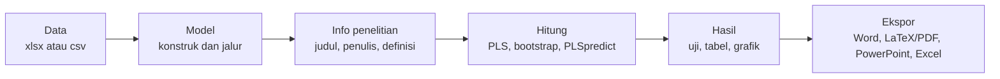

<p align="center">
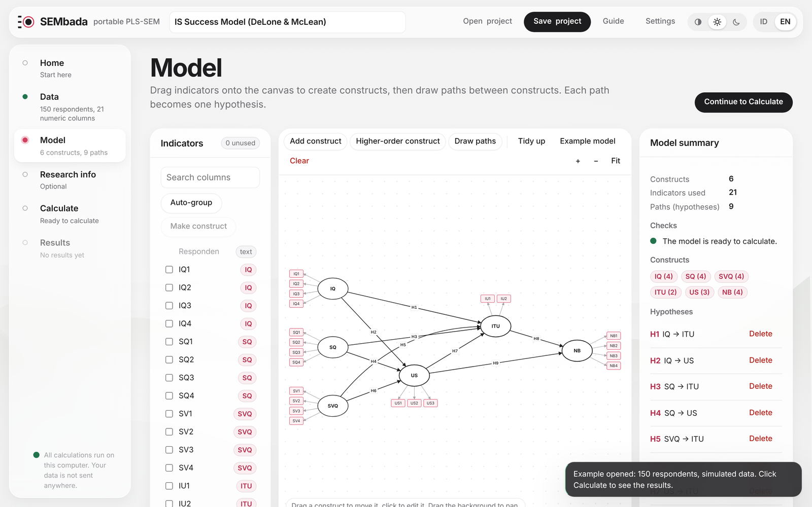
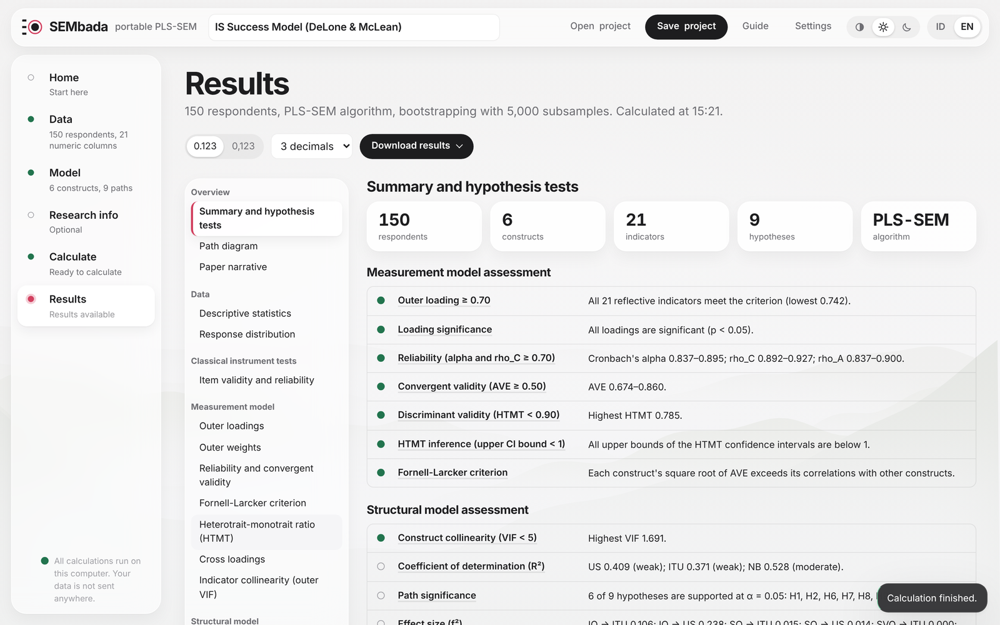
</p>

## Model

Model jalur PLS terdiri atas dua bagian. **Model pengukuran (*outer model*)** menghubungkan setiap konstruk dengan indikatornya, sedangkan **model struktural (*inner model*)** menghubungkan antarkonstruk.

<p align="center">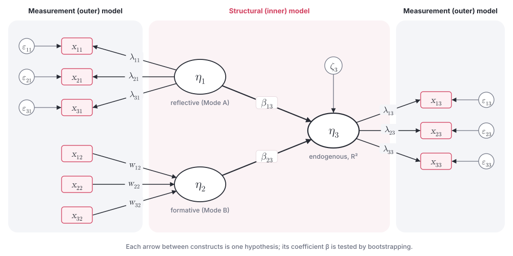</p>

Misalkan $`\eta_j`$ $`(j = 1,\ldots,J)`$ adalah konstruk, $`x_{kj}`$ indikator ke-$`k`$ dari konstruk $`j`$, dan $`P_j`$ himpunan konstruk yang memiliki jalur menuju $`\eta_j`$.

**Model pengukuran.** Konstruk reflektif menyebabkan indikatornya, sedangkan konstruk formatif adalah komposit berbobot dari indikatornya:

```math
x_{kj} = \lambda_{kj}\,\eta_{j} + \varepsilon_{kj} \qquad\text{(reflektif)}, \qquad\qquad \eta_{j} = \sum_{k=1}^{K_j} w_{kj}\,x_{kj} \qquad\text{(formatif)}
```

**Model struktural.** Setiap konstruk endogen merupakan fungsi linear dari konstruk pendahulunya ditambah gangguan:

```math
\eta_{j} = \sum_{i \in P_{j}} \beta_{ij}\,\eta_{i} + \zeta_{j}
```

Setiap koefisien $`\beta_{ij}`$ mewakili satu hipotesis.

## Estimasi

SEMbada menerapkan algoritma PLS iteratif dari Wold dan Lohmöller. Indikator distandarkan, semua bobot luar diawali dengan 1, lalu tiga langkah diulang sampai bobot tidak lagi berubah.

<p align="center">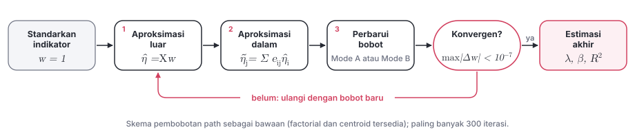</p>

**Langkah 1 dan 2: aproksimasi luar dan dalam.** Skor setiap konstruk adalah jumlah berbobot dari indikator terstandar yang diskalakan agar variansnya 1, lalu didekati oleh konstruk tetangganya dalam model jalur:

```math
\hat{\eta}_{j} = \sum_{k=1}^{K_{j}} w_{kj}\,x_{kj}, \qquad \tilde{\eta}_{j} = \sum_{i \neq j} e_{ij}\,\hat{\eta}_{i}
```

Dengan skema pembobotan *path* (bawaan), $`e_{ij} = b_{ij}`$ bila $`i \in P_j`$ (koefisien regresi $`\hat\eta_i`$ ketika $`\hat\eta_j`$ diregresikan pada konstruk pendahulunya), $`e_{ij} = \mathrm{cor}(\hat\eta_i,\hat\eta_j)`$ bila $`j \in P_i`$, dan $`e_{ij} = 0`$ untuk lainnya. Skema *factorial* memakai korelasinya dan skema *centroid* memakai tandanya, untuk semua konstruk yang bertetangga.

**Langkah 3: pembaruan bobot.** Konstruk reflektif memakai Mode A (bobot korelasi) dan konstruk formatif memakai Mode B (bobot regresi). Perulangan berhenti bila $`\max_k \lvert w_k^{(s+1)} - w_k^{(s)} \rvert < 10^{-7}`$, dengan paling banyak 300 iterasi (keduanya bisa diubah):

```math
w_{kj} \propto \mathrm{cov}\left(x_{kj},\,\tilde{\eta}_{j}\right) \quad \text{(Mode A)}, \qquad \mathbf{w}_{j} = \left(\mathbf{X}_{j}^{\top}\mathbf{X}_{j}\right)^{-1}\mathbf{X}_{j}^{\top}\tilde{\boldsymbol{\eta}}_{j} \quad \text{(Mode B)}
```

**Estimasi akhir.** Loading adalah $`\lambda_{kj} = \mathrm{cor}(x_{kj},\hat\eta_j)`$. Koefisien jalur setiap konstruk endogen diestimasi dengan kuadrat terkecil pada skor akhir, $`\hat{\boldsymbol\beta}_{j} = (\hat{\mathbf H}_{P_j}^{\top}\hat{\mathbf H}_{P_j})^{-1}\hat{\mathbf H}_{P_j}^{\top}\hat{\boldsymbol\eta}_{j}`$, dengan $`\hat{\mathbf H}_{P_j}`$ berisi skor konstruk pendahulu dari konstruk $`j`$.

**PLS konsisten (PLSc).** Untuk konstruk reflektif, PLSc mengoreksi pelemahan skor komposit dengan koefisien reliabilitas $`\rho_A`$ (Dijkstra dan Henseler), lalu mengestimasi jalur dari korelasi antarkonstruk yang sudah dikoreksi:

```math
\rho_{A} = \left(\hat{\mathbf{w}}^{\top}\hat{\mathbf{w}}\right)^{2}\frac{\hat{\mathbf{w}}^{\top}\left(\mathbf{S}-\mathrm{diag}\,\mathbf{S}\right)\hat{\mathbf{w}}}{\hat{\mathbf{w}}^{\top}\left(\hat{\mathbf{w}}\hat{\mathbf{w}}^{\top}-\mathrm{diag}(\hat{\mathbf{w}}\hat{\mathbf{w}}^{\top})\right)\hat{\mathbf{w}}}
```

```math
\hat{\boldsymbol\lambda}_{j} = \hat c_{j}\,\hat{\mathbf w}_{j}, \qquad \hat c_{j}^{2} = \frac{\rho_{A,j}}{\left(\hat{\mathbf w}_{j}^{\top}\hat{\mathbf w}_{j}\right)^{2}}, \qquad \widetilde{\mathrm{cor}}(\eta_i,\eta_j) = \frac{\mathrm{cor}(\hat\eta_i,\hat\eta_j)}{\sqrt{\rho_{A,i}\,\rho_{A,j}}}
```

## Evaluasi model pengukuran

**Reliabilitas konsistensi internal** (untuk konstruk reflektif dengan lebih dari satu butir):

```math
\alpha = \frac{K}{K-1}\left(1 - \frac{\sum_{k=1}^{K}\sigma_{k}^{2}}{\sigma_{t}^{2}}\right)
```

```math
\rho_{C} = \frac{\left(\sum_{k=1}^{K}\lambda_{k}\right)^{2}}{\left(\sum_{k=1}^{K}\lambda_{k}\right)^{2} + \sum_{k=1}^{K}\left(1-\lambda_{k}^{2}\right)}
```

**Validitas konvergen:**

```math
\mathrm{AVE} = \frac{1}{K}\sum_{k=1}^{K}\lambda_{k}^{2}
```

**Validitas diskriminan.** Rasio *heterotrait–monotrait* membandingkan rata-rata korelasi antara indikator dari konstruk yang berbeda, $`\bar r_{ij}`$, dengan rata-rata korelasi antarindikator dalam konstruk yang sama, $`\bar r_{ii}`$:

```math
\mathrm{HTMT}_{ij} = \frac{\bar{r}_{ij}}{\sqrt{\bar{r}_{ii}\,\bar{r}_{jj}}}
```

SEMbada juga melaporkan interval kepercayaan bootstrap untuk HTMT, kriteria Fornell–Larcker $`\sqrt{\mathrm{AVE}_j} > \max_{i\neq j}\lvert\mathrm{cor}(\hat\eta_i,\hat\eta_j)\rvert`$, dan *cross loading*.

**Kolinearitas** antarindikator formatif dan antarprediktor dalam model struktural, dengan $`R_k^2`$ adalah $`R^2`$ dari regresi variabel $`k`$ terhadap variabel lainnya:

```math
\mathrm{VIF}_{k} = \frac{1}{1 - R_{k}^{2}}
```

| Kriteria | Pedoman yang dipakai pada ringkasan hasil |
|---|---|
| Loading indikator | ≥ 0,708 (≥ 0,70 dalam praktik) |
| Cronbach's α, ρ<sub>A</sub>, ρ<sub>C</sub> | 0,70 sampai 0,95 |
| AVE | ≥ 0,50 |
| HTMT | < 0,90 untuk konstruk yang mirip secara konseptual, < 0,85 untuk konstruk yang berbeda; batas atas bootstrap sebaiknya di bawah 1 |
| VIF | < 3 ideal, < 5 masih dapat diterima |
| f² | 0,02 kecil, 0,15 sedang, 0,35 besar |
| R² | 0,25 lemah, 0,50 moderat, 0,75 substansial |
| Q²<sub>predict</sub> | > 0 |
| SRMR | < 0,08 |

## Evaluasi model struktural

**Varians terjelaskan dan ukuran efek.** $`p_j`$ adalah banyaknya prediktor konstruk $`j`$, dan ukuran efek membandingkan $`R^2`$ dengan dan tanpa satu prediktor:

```math
R_{j}^{2} = 1 - \frac{\mathrm{Var}(\hat{\zeta}_{j})}{\mathrm{Var}(\hat{\eta}_{j})},\qquad R_{\mathrm{adj}}^{2} = 1 - \left(1 - R_{j}^{2}\right)\frac{n-1}{n-p_{j}-1}
```

```math
f^{2} = \frac{R_{\mathrm{incl}}^{2} - R_{\mathrm{excl}}^{2}}{1 - R_{\mathrm{incl}}^{2}}
```

**Bootstrapping.** SEMbada mengambil $`B`$ subsampel dengan pengembalian (bawaan 5.000, paling banyak 10.000), mengestimasi ulang model pada setiap subsampel, lalu memakai sebaran estimasinya:

```math
t = \frac{\hat{\beta}}{\mathrm{SE}^{*}}, \qquad \mathrm{SE}^{*} = \sqrt{\frac{1}{B-1}\sum_{b=1}^{B}\left(\hat{\beta}_{b}^{*} - \bar{\beta}^{*}\right)^{2}}
```

```math
p = 2\left[1 - F_{t,\,B-1}\!\left(\lvert t\rvert\right)\right] \qquad\text{(dua arah)}
```

Interval persentil memakai kuantil empiris dari estimasi bootstrap:

```math
\mathrm{CI}_{1-\alpha} = \left[\hat{\beta}^{*}_{(\alpha/2)},\ \hat{\beta}^{*}_{(1-\alpha/2)}\right]
```

Interval BCa (*bias-corrected and accelerated*) menyesuaikan kuantil tersebut dengan suku bias $`\hat z_0`$ dan percepatan jackknife $`\hat a`$, dengan $`\hat\beta_{(i)}`$ estimasi tanpa observasi ke-$`i`$:

```math
\hat z_0 = \Phi^{-1}\!\left(\frac{\#\{\hat\beta^{*}_{b} < \hat\beta\}}{B}\right), \qquad \hat a = \frac{\sum_{i}\left(\bar\beta_{(\cdot)} - \hat\beta_{(i)}\right)^{3}}{6\left[\sum_{i}\left(\bar\beta_{(\cdot)} - \hat\beta_{(i)}\right)^{2}\right]^{3/2}}
```

```math
\alpha_{1} = \Phi\!\left(\hat z_0 + \frac{\hat z_0 + z_{\alpha/2}}{1 - \hat a\,(\hat z_0 + z_{\alpha/2})}\right), \qquad \alpha_{2} = \Phi\!\left(\hat z_0 + \frac{\hat z_0 + z_{1-\alpha/2}}{1 - \hat a\,(\hat z_0 + z_{1-\alpha/2})}\right), \qquad \mathrm{CI}_{\mathrm{BCa}} = \left[\hat\beta^{*}_{(\alpha_1)},\ \hat\beta^{*}_{(\alpha_2)}\right]
```

**Mediasi.** Efek tidak langsung spesifik adalah hasil kali koefisien di sepanjang jalurnya, sedangkan efek total menghimpun semua efek langsung dan tidak langsung. Dengan $`\mathbf B`$ matriks koefisien jalur,

```math
\beta_{X \rightarrow M \rightarrow Y} = \beta_{XM}\,\beta_{MY}
```

```math
\mathbf T = \left(\mathbf I - \mathbf B\right)^{-1} - \mathbf I, \qquad \text{efek tidak langsung} = \mathbf T - \mathbf B
```

Setiap efek tidak langsung diberi interval kepercayaan bootstrap.

**Kecocokan model.** *Standardized root mean square residual* membandingkan korelasi indikator teramati $`r_{ij}`$ dengan korelasi yang diimplikasikan model $`\hat r_{ij}`$:

```math
\mathrm{SRMR} = \sqrt{\frac{2}{p(p+1)}\sum_{i \le j}\left(r_{ij} - \hat{r}_{ij}\right)^{2}}
```

**Kekuatan prediksi (PLSpredict).** Dengan validasi silang $`k`$-*fold* yang diulang beberapa kali, setiap indikator konstruk endogen diprediksi untuk responden yang tidak ikut diestimasi, lalu dibandingkan dengan rata-rata data latih dan dengan pembanding regresi linear:

```math
Q_{\mathrm{predict}}^{2} = 1 - \frac{\sum_{i}\left(y_{i} - \hat{y}_{i}\right)^{2}}{\sum_{i}\left(y_{i} - \bar{y}_{\mathrm{train}}\right)^{2}}
```

```math
\mathrm{RMSE} = \sqrt{\frac{1}{N}\sum_{i=1}^{N}\left(y_{i} - \hat{y}_{i}\right)^{2}},\qquad \mathrm{MAE} = \frac{1}{N}\sum_{i=1}^{N}\left|y_{i} - \hat{y}_{i}\right|
```

Galat prediksi (RMSE atau MAE) yang lebih kecil daripada pembanding linear pada sebagian besar indikator menunjukkan kekuatan prediksi sedang hingga tinggi.

## Analisis lanjutan

**Moderasi (pendekatan dua tahap).** Tahap 1 mengestimasi model tanpa interaksi dan menyimpan skor konstruk. Tahap 2 menambahkan hasil kali skor terstandar sebagai prediktor baru:

```math
\eta_{X \times M} = \hat{\eta}_{X}\,\hat{\eta}_{M}
```

Pengaruh $`X`$ terhadap $`Y`$ lalu bergantung pada moderator. SEMbada menggambar *simple slope* pada $`M = -1`$, $`0`$, dan $`+1`$ simpangan baku:

```math
\frac{\partial \eta_{Y}}{\partial \eta_{X}} = \beta_{XY} + \beta_{(X \times M)Y}\,\eta_{M}
```

**Konstruk orde tinggi (pendekatan dua tahap terpisah).** Tahap 1 mengestimasi konstruk orde rendah; tahap 2 memakai skor mereka sebagai indikator konstruk orde tinggi $`\xi_H`$, yang kemudian menggantikan konstruk orde rendah dalam model struktural:

```math
\hat{\eta}_{l} = \lambda_{l}\,\xi_{H} + \varepsilon_{l}, \quad l = 1, \ldots, L
```

**Analisis multigrup (MGA).** Sebelum membandingkan kelompok, SEMbada menjalankan MICOM. Langkah 2 (invariansi komposisional) mengorelasikan skor komposit yang dibentuk dengan bobot masing-masing kelompok,

```math
c_{j} = \mathrm{cor}\left(\mathbf{X}\mathbf{w}_{j}^{(1)},\, \mathbf{X}\mathbf{w}_{j}^{(2)}\right)
```

lalu membandingkan $`c_j`$ dengan distribusi permutasinya. Langkah 3 menguji kesamaan rata-rata dan varians komposit. Selisih koefisien jalur $`\Delta\beta = \beta^{(1)} - \beta^{(2)}`$ diuji dengan $`P`$ kali pengacakan ulang keanggotaan kelompok,

```math
p = \frac{\#\left\{\lvert\Delta\beta^{*}\rvert \geq \lvert\Delta\beta\rvert\right\} + 1}{P + 1}
```

bersama uji parametrik dan uji Welch–Satterthwaite berdasarkan bootstrapping per kelompok.

**Analisis peta kepentingan–kinerja (IPMA).** Indikator diskalakan ulang ke 0–100, dan bobot dikembalikan ke skala aslinya lalu dinormalkan di dalam setiap konstruk:

```math
\tilde{w}_{kj} = \frac{w_{kj}/s_{k}}{\sum_{l \in B_{j}} w_{lj}/s_{l}}
```

```math
\mathrm{Perf}_{j} = \frac{1}{n}\sum_{i=1}^{n}\sum_{k \in B_{j}} \tilde{w}_{kj}\,\frac{x_{ik} - \min_{k}}{\max_{k} - \min_{k}} \times 100
```

Kepentingan konstruk $`j`$ terhadap konstruk sasaran $`t`$ adalah efek total tak terstandarnya:

```math
\mathrm{Imp}_{j} = \left[\left(\mathbf{I} - \tilde{\mathbf{B}}\right)^{-1} - \mathbf{I}\right]_{jt}
```

**Ukuran sampel minimum (metode *inverse square root*).** Untuk taraf signifikansi 5% dan kuasa uji 80%,

```math
n_{\min} > \left(\frac{2{,}486}{\lvert\beta_{\min}\rvert}\right)^{2}
```

dengan $`\beta_{\min}`$ koefisien jalur absolut terkecil yang diharapkan signifikan. SEMbada memakai jalur signifikan terkecil dalam hasil Anda, atau jalur terkecil bila tidak ada yang signifikan.

## Gambar dan diagram jalur

Diagram jalur digambar sendiri oleh SEMbada dan bisa diubah langsung di halaman hasil: seret konstruk dan label angka, klik konstruk untuk memindah letak indikatornya, atau klik jalur untuk membuatnya lurus atau melengkung. Posisi tersimpan di proyek dan dipakai di semua ekspor.

<p align="center">
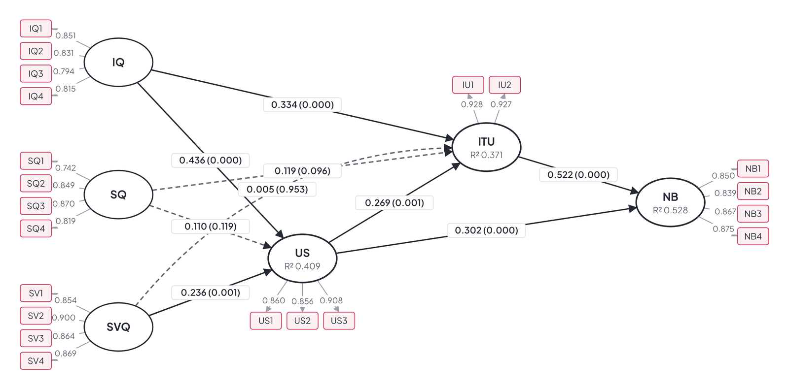
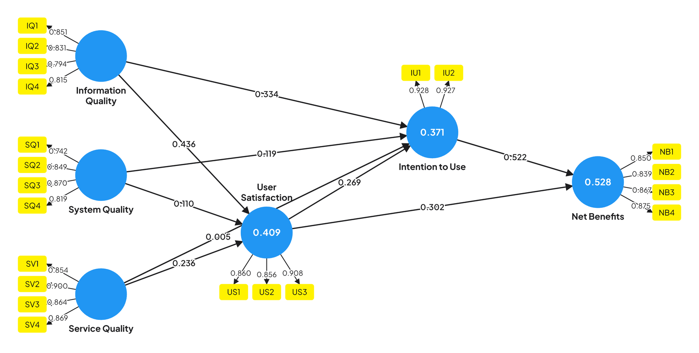
</p>

Panel **Sesuaikan tampilan** menyediakan empat gaya siap pakai (SEMbada, lingkaran biru, hitam-putih untuk jurnal, minimal) serta pengaturan rinci untuk bentuk konstruk, nama lengkap atau singkatan, cara menampilkan R², indikator dan loading, label berbingkai atau polos, bintang signifikansi, jalur tidak signifikan putus-putus, garis lurus, otomatis, atau melengkung (dengan kelengkungan yang bisa diatur), warna, ukuran huruf, tebal garis, serta resolusi dan transparansi PNG.

<p align="center">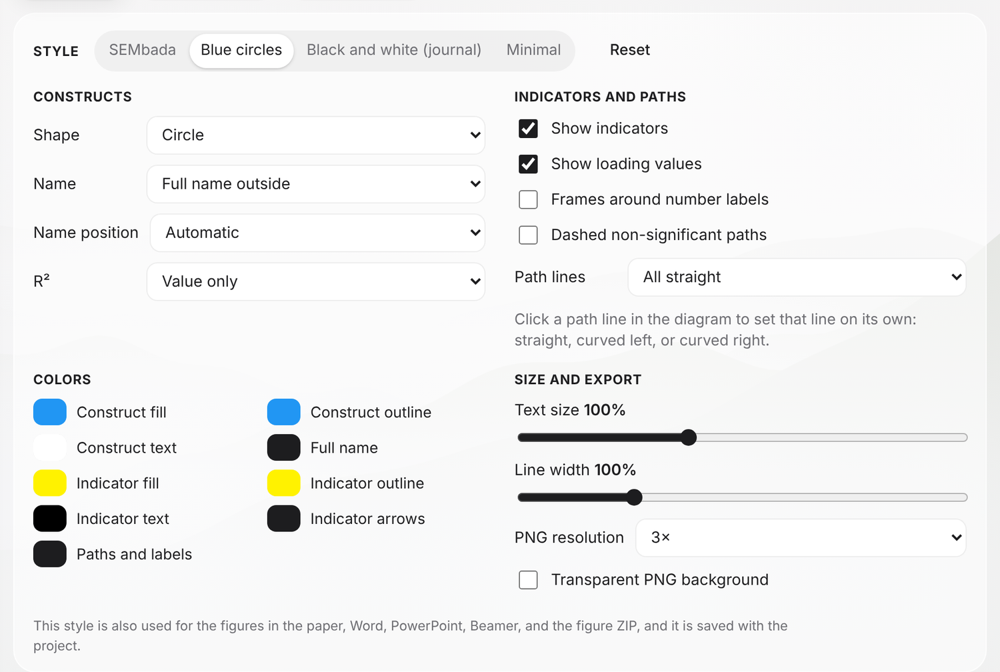</p>

Setiap bagian hasil memiliki grafiknya sendiri, tersedia di aplikasi dan sebagai PNG atau SVG:

| | |
|---|---|
| 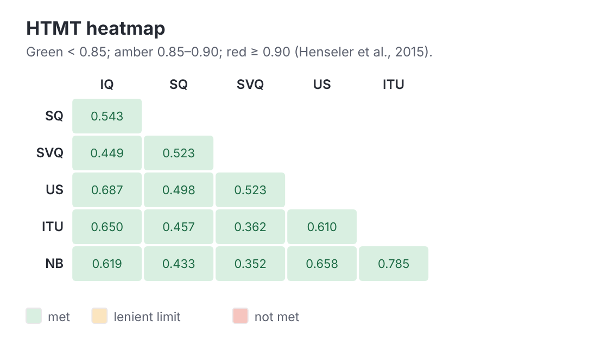 | 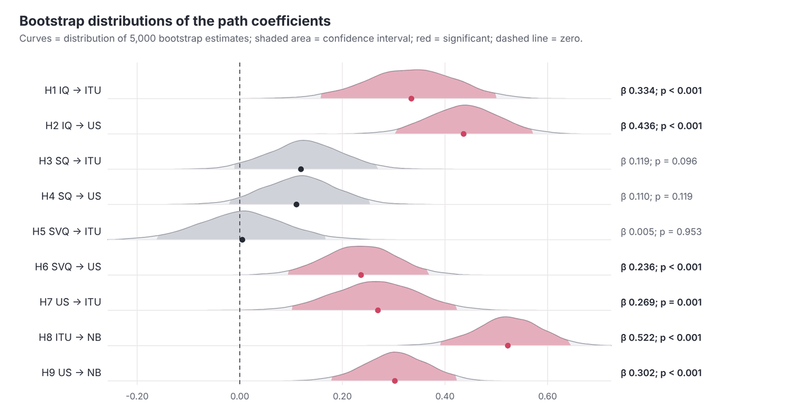 |
| 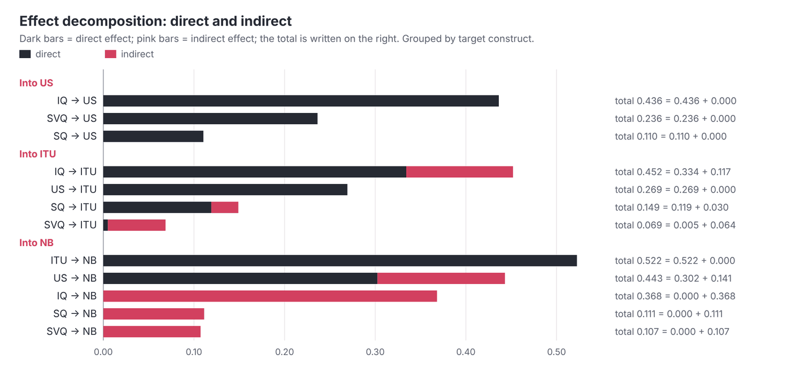 | 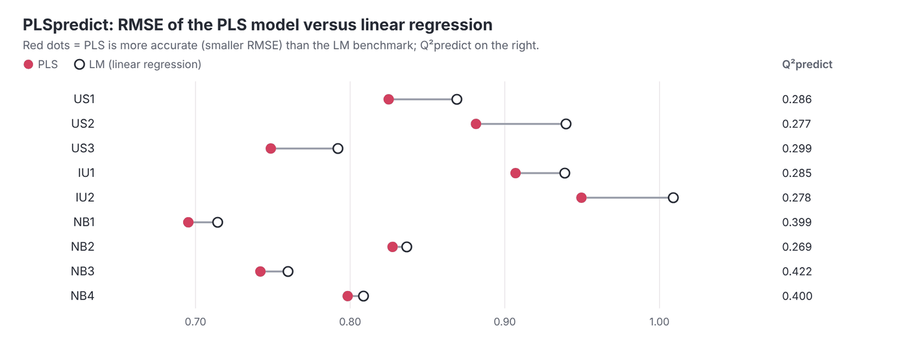 |
| 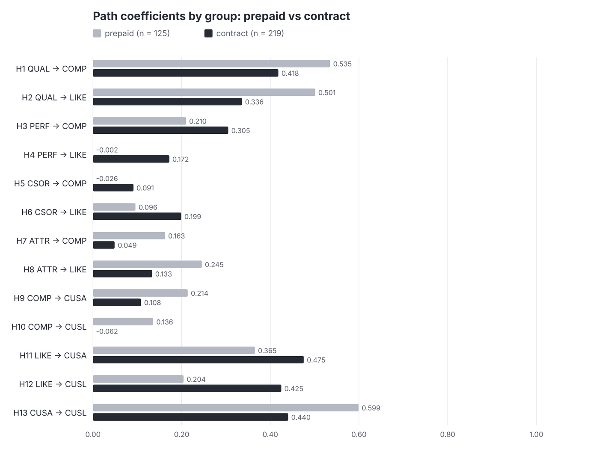 | 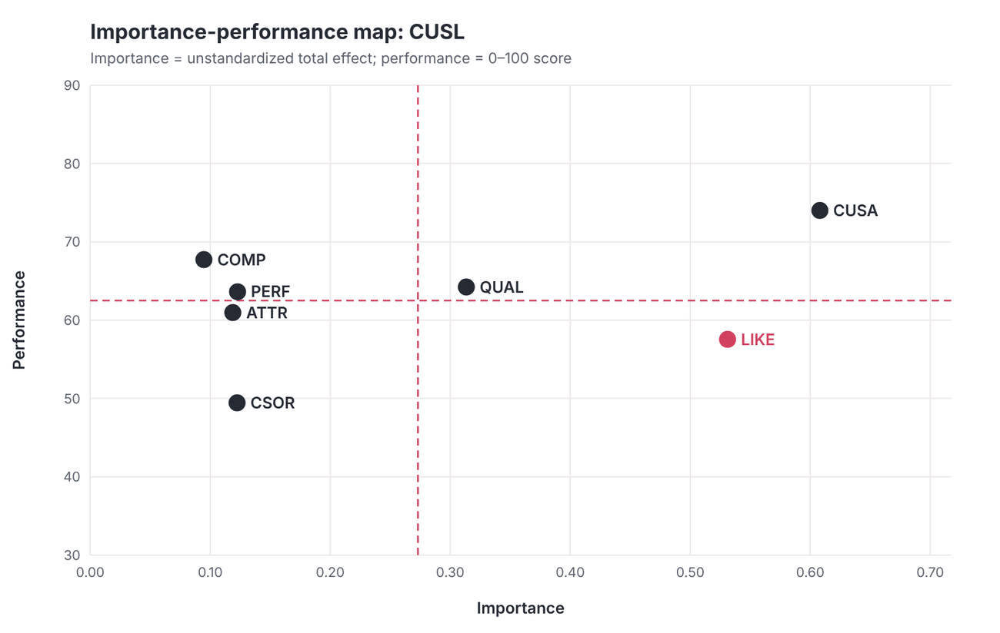 |

## Ekspor

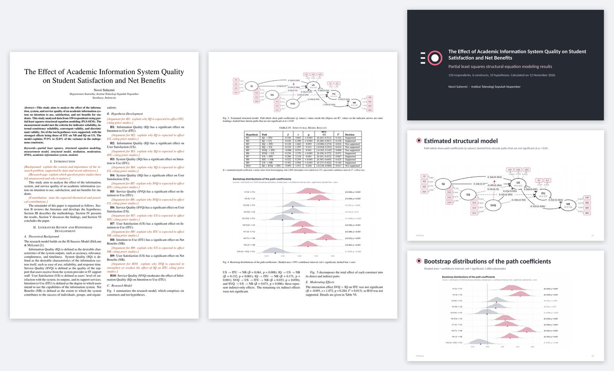

| Format | Isi |
|---|---|
| Laporan Word (.docx) | Semua tabel hasil beserta catatan dan interpretasinya |
| Makalah (Word, LaTeX, atau PDF) | Naskah dua kolom gaya konferensi: pendahuluan, hipotesis, metode, hasil, pembahasan, dan lampiran rumus estimasi. Penanda khusus menunjukkan bagian yang hanya bisa ditulis oleh penulis. PDF dikompilasi di dalam aplikasi dengan mesin LaTeX bawaan |
| Slide (PowerPoint atau Beamer) | Metode, model pengukuran, model struktural, dan analisis lanjutan, dengan persamaan yang dirender LaTeX |
| Excel (.xlsx) | Setiap tabel hasil dalam lembar tersendiri |
| Gambar (.zip) | Semua grafik dan diagram jalur dalam PNG dan SVG |
| Proyek (.sembada.json) | Data, model, pengaturan, dan tata letak diagram untuk dibuka kembali |
| Kode R | Skrip seminr yang setara: tampil di halaman hasil dengan tombol salin, dilampirkan di laporan Word, dan disertakan di file Excel |

Dokumen bisa dibuat dalam bahasa Indonesia atau Inggris, terlepas dari bahasa antarmuka.

## Validasi terhadap R

Mesin PLS-nya sudah dibandingkan dengan paket R **seminr** pada dataset bawaan. Bobot luar, loading, koefisien jalur, R², koefisien reliabilitas, HTMT, dan ukuran efek sama hingga presisi numerik; PLS konsisten dan beberapa dataset juga dicek dengan **cSEM**. Bootstrapping dan PLSpredict memakai pengambilan sampel acak: dengan *seed* yang sama, SEMbada selalu menghasilkan angka yang sama, tetapi pembangkit bilangan acaknya berbeda dari R sehingga statistik berbasis pengambilan ulang bisa berbeda di desimal ketiga. Analisis lanjutan (moderasi dua tahap, konstruk orde tinggi dua tahap terpisah, IPMA, serta MGA dengan MICOM) dicek silang dengan implementasi independen, dengan selisih di bawah 10<sup>−10</sup>.

## Dataset contoh

Semua contoh sudah tertanam di aplikasi (Beranda, *Buka contoh*) dan juga tersedia sebagai file CSV di [`data/examples`](data/examples). Sumber dan lisensinya tercantum di [`data/README.md`](data/README.md).

| File | Model | n | Data |
|---|---|---|---|
| contoh_delone_mclean_simulasi.csv | Kesuksesan SI (DeLone & McLean) | 150 | simulasi |
| contoh_tam_simulasi.csv | Technology acceptance model | 240 | simulasi |
| contoh_utaut2_simulasi.csv | UTAUT2 | 320 | simulasi |
| contoh_tpb_simulasi.csv | Theory of planned behavior | 260 | simulasi |
| contoh_servqual_simulasi.csv | Kualitas layanan, kepuasan, dan loyalitas | 300 | simulasi |
| ecsi_mobile_phone.csv | Kepuasan pelanggan ACSI / ECSI | 250 | asli |
| corporate_reputation.csv | Reputasi perusahaan | 344 | asli |
| bank_satisfaction_gender.csv | Kepuasan nasabah bank | 250 | asli |
| influencer_marketing.csv | Pemasaran influencer (moderasi) | 222 | asli |
| brand_equity_yoo2000.csv | Bauran pemasaran dan ekuitas merek (orde tinggi) | 569 | simulasi dari korelasi terbitan |
| privacy_location_tracker.csv | Kekhawatiran privasi dan adopsi (mediasi) | 1.090 | asli |

## Privasi

SEMbada tidak memiliki server. Semua perhitungan berlangsung di browser atau aplikasi desktop Anda, dan data Anda tidak pernah keluar dari perangkat. Bila dibuka dari alamat web, aplikasi disimpan di cache sehingga tetap bisa dipakai tanpa koneksi internet.

## Struktur repositori dan membangun dari sumber

```
app/      SEMbada_PLS-SEM.html, aplikasi lengkap dalam satu file (buka di browser)
src/      kode sumber aplikasi: mesin PLS, antarmuka, pengekspor
data/     dataset contoh bawaan (samples.json) dan salinan CSV-nya
eq/       persamaan yang sudah dirender untuk aplikasi, Word, dan slide
fonts/    Plus Jakarta Sans dan Inter (SIL Open Font License)
vendor/   docx, PptxGenJS, dan mesin SwiftLaTeX beserta lisensinya
docs/img/ ilustrasi untuk README ini
tools/    cara dataset contoh disiapkan
build.py  membangun app/SEMbada_PLS-SEM.html dari kode sumber
```

Untuk membangun ulang aplikasi, cukup Python 3.9 atau yang lebih baru:

```bash
python3 build.py
```

Hasilnya, `app/SEMbada_PLS-SEM.html`, identik dengan file yang diterbitkan di sini. File yang sama bisa dipasang sebagai halaman statis (misalnya di Posit Connect, GitHub Pages, atau server web mana pun) atau dibungkus sebagai aplikasi desktop.

## Sitasi

Bila SEMbada membantu penelitian Anda, mohon sitasi. GitHub menampilkan rinciannya di **Cite this repository**; aplikasi ini juga menuliskan rujukannya di setiap makalah yang dihasilkan.

> Suhermi, N. (2026). *SEMbada: Portable PLS-SEM software* (Version 1.11.1) [Computer software]. https://github.com/novrisuhermi/sembada

```bibtex
@software{suhermi2026sembada,
  author  = {Suhermi, Novri},
  title   = {SEMbada: Portable PLS-SEM software},
  version = {1.11.1},
  year    = {2026},
  url     = {https://github.com/novrisuhermi/sembada}
}
```

## Referensi

- Becker, J.-M., Klein, K., & Wetzels, M. (2012). Hierarchical latent variable models in PLS-SEM: Guidelines for using reflective-formative type models. *Long Range Planning, 45*(5–6), 359–394.
- Dijkstra, T. K., & Henseler, J. (2015). Consistent partial least squares path modeling. *MIS Quarterly, 39*(2), 297–316.
- Efron, B. (1987). Better bootstrap confidence intervals. *Journal of the American Statistical Association, 82*(397), 171–185.
- Fornell, C., & Larcker, D. F. (1981). Evaluating structural equation models with unobservable variables and measurement error. *Journal of Marketing Research, 18*(1), 39–50.
- Hair, J. F., Hult, G. T. M., Ringle, C. M., & Sarstedt, M. (2022). *A primer on partial least squares structural equation modeling (PLS-SEM)* (3rd ed.). Sage.
- Hair, J. F., Hult, G. T. M., Ringle, C. M., Sarstedt, M., Danks, N. P., & Ray, S. (2021). *Partial least squares structural equation modeling (PLS-SEM) using R: A workbook*. Springer.
- Henseler, J., & Chin, W. W. (2010). A comparison of approaches for the analysis of interaction effects between latent variables using partial least squares path modeling. *Structural Equation Modeling, 17*(1), 82–109.
- Henseler, J., Ringle, C. M., & Sarstedt, M. (2015). A new criterion for assessing discriminant validity in variance-based structural equation modeling. *Journal of the Academy of Marketing Science, 43*(1), 115–135.
- Henseler, J., Ringle, C. M., & Sarstedt, M. (2016). Testing measurement invariance of composites using partial least squares. *International Marketing Review, 33*(3), 405–431.
- Hu, L., & Bentler, P. M. (1999). Cutoff criteria for fit indexes in covariance structure analysis: Conventional criteria versus new alternatives. *Structural Equation Modeling, 6*(1), 1–55.
- Kock, N., & Hadaya, P. (2018). Minimum sample size estimation in PLS-SEM: The inverse square root and gamma-exponential methods. *Information Systems Journal, 28*(1), 227–261.
- Lohmöller, J.-B. (1989). *Latent variable path modeling with partial least squares*. Physica.
- Rademaker, M. E., & Schuberth, F. *cSEM: Composite-based structural equation modeling* [R package]. https://CRAN.R-project.org/package=cSEM
- Ray, S., Danks, N. P., & Calero Valdez, A. *seminr: Building and estimating structural equation models* [R package]. https://CRAN.R-project.org/package=seminr
- Ringle, C. M., & Sarstedt, M. (2016). Gain more insight from your PLS-SEM results: The importance-performance map analysis. *Industrial Management & Data Systems, 116*(9), 1865–1886.
- Sarstedt, M., Henseler, J., & Ringle, C. M. (2011). Multigroup analysis in partial least squares (PLS) path modeling: Alternative methods and empirical results. *Advances in International Marketing, 22*, 195–218.
- Shmueli, G., Sarstedt, M., Hair, J. F., Cheah, J.-H., Ting, H., Vaithilingam, S., & Ringle, C. M. (2019). Predictive model assessment in PLS-SEM: Guidelines for using PLSpredict. *European Journal of Marketing, 53*(11), 2322–2347.
- Tenenhaus, M., Esposito Vinzi, V., Chatelin, Y.-M., & Lauro, C. (2005). PLS path modeling. *Computational Statistics & Data Analysis, 48*(1), 159–205.
- Wold, H. (1982). Soft modeling: The basic design and some extensions. In K. G. Jöreskog & H. Wold (Eds.), *Systems under indirect observation, Part II* (pp. 1–54). North-Holland.

## Perangkat lunak pihak ketiga dan lisensi

SEMbada menyertakan docx (MIT), PptxGenJS (MIT), JSZip (MIT), mesin pdfTeX SwiftLaTeX (AGPL-3.0) beserta komponen TeX Live dengan lisensi bebasnya masing-masing, serta huruf Plus Jakarta Sans dan Inter (SIL Open Font License 1.1). Versi desktop memakai Neutralinojs (MIT). Dataset contoh yang asli berasal dari paket R seminr, cSEM, dan plspm (GPL-3). Rinciannya ada di [`THIRD_PARTY_NOTICES.md`](THIRD_PARTY_NOTICES.md) dan di aplikasi pada *Panduan → Tentang*.

<p align="center"><sub>SEMbada dikembangkan oleh Novri Suhermi, Institut Teknologi Sepuluh Nopember, Surabaya, Indonesia.</sub></p>
