<p align="center"></p>
<h1 align="center">SEMbada</h1>
<p align="center"><b>Portable PLS-SEM for everyone.</b><br>
From questionnaire data to measurement and structural model results, publication-ready figures, and draft manuscripts, entirely on your own computer.</p>

<p align="center">
<a href="https://novrisuhermi-sem.share.connect.posit.cloud"><b>Open the app</b></a> &nbsp;·&nbsp;
<a href="app/SEMbada_PLS-SEM.html">Portable app (one HTML file)</a> &nbsp;·&nbsp;
<a href="https://github.com/novrisuhermi/sembada/releases">Windows and macOS builds</a> &nbsp;·&nbsp;
<a href="README.id.md">Bahasa Indonesia</a>
</p>

<p align="center">


</p>

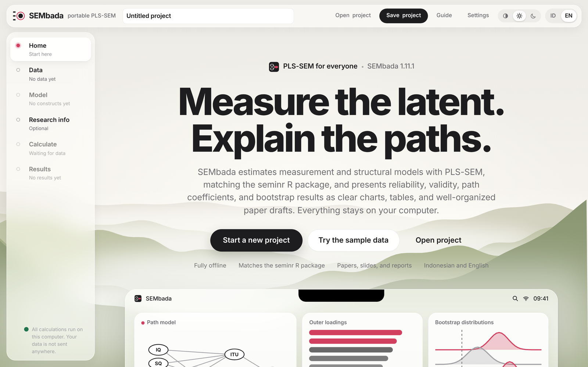

**SEMbada** estimates partial least squares structural equation models (PLS-SEM) from survey data and explains every result in plain language. It is written in JavaScript and runs as a single HTML file, in the browser or as a desktop app, with no installation, no R, and no upload of your data. Its estimates were checked against the R package **seminr**, and every analysis comes with the equivalent R code for independent replication.

## Contents

- [What it does](#what-it-does)
- [Quick start](#quick-start)
- [Workflow](#workflow)
- [The model](#the-model)
- [Estimation](#estimation)
- [Assessing the measurement model](#assessing-the-measurement-model)
- [Assessing the structural model](#assessing-the-structural-model)
- [Advanced analyses](#advanced-analyses)
- [Figures and the path diagram](#figures-and-the-path-diagram)
- [Exports](#exports)
- [Validation against R](#validation-against-r)
- [Example datasets](#example-datasets)
- [Privacy](#privacy)
- [Repository layout and building from source](#repository-layout-and-building-from-source)
- [Citation](#citation)
- [References](#references)
- [Third-party software and licences](#third-party-software-and-licences)

## What it does

| Area | What SEMbada provides |
|---|---|
| Data | Excel (.xlsx) or CSV import, user-defined missing-value codes, mean replacement or casewise deletion, descriptive statistics, response distributions, classical item validity and reliability |
| Model | Drag-and-drop path model builder; reflective (Mode A) and formative (Mode B) constructs; automatic grouping of indicators by name; 12 ready-made models with data (DeLone & McLean, TAM, UTAUT2, TPB, SERVQUAL, ACSI/ECSI, corporate reputation, and more) |
| Estimation | PLS-SEM with path, factorial, or centroid weighting; consistent PLS (PLSc) |
| Inference | Bootstrapping with up to 10,000 subsamples, percentile or BCa intervals, one- or two-tailed tests |
| Measurement model | Loadings and weights, Cronbach's α, ρ<sub>A</sub>, ρ<sub>C</sub>, AVE, Fornell–Larcker, HTMT with bootstrap intervals, cross loadings, outer VIF |
| Structural model | Path coefficients, R², adjusted R², f², inner VIF, specific indirect and total effects, SRMR, PLSpredict (Q²<sub>predict</sub>, RMSE, MAE against a linear benchmark) |
| Advanced | Moderation (two-stage), higher-order constructs (disjoint two-stage), multigroup analysis with MICOM and permutation tests, importance–performance map (IPMA), minimum sample size (inverse square root method) |
| Output | Word report, two-column conference-style paper (Word, LaTeX, PDF), PowerPoint and Beamer slides, Excel tables, figure ZIP (PNG and SVG), project file, equivalent R code for seminr |
| Interface | English and Indonesian (documents can use a different language from the interface), light and dark themes, desktop, tablet, and phone |

## Quick start

1. **Open SEMbada.** Use the hosted app at [novrisuhermi-sem.share.connect.posit.cloud](https://novrisuhermi-sem.share.connect.posit.cloud), or download [`app/SEMbada_PLS-SEM.html`](app/SEMbada_PLS-SEM.html) and open it in any modern browser. It works offline.
2. **Data.** Drag in an Excel or CSV file. The first row holds the column names and each row is one respondent.
3. **Model.** Click *Auto-group* or drag indicators onto the canvas, choose reflective or formative, and draw the paths. Each path becomes a hypothesis H1, H2, and so on.
4. **Calculate.** The defaults are PLS-SEM with the path weighting scheme, bootstrapping with 5,000 subsamples, and PLSpredict with 10 folds and 10 repetitions.
5. **Results.** Read the pass/fail summary and the hypothesis table, inspect the charts, and download the documents you need.

No data at hand? Choose **Try the sample data** on the home screen, or open one of the twelve example models.

## Workflow

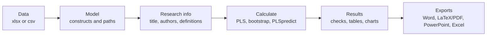

<p align="center">
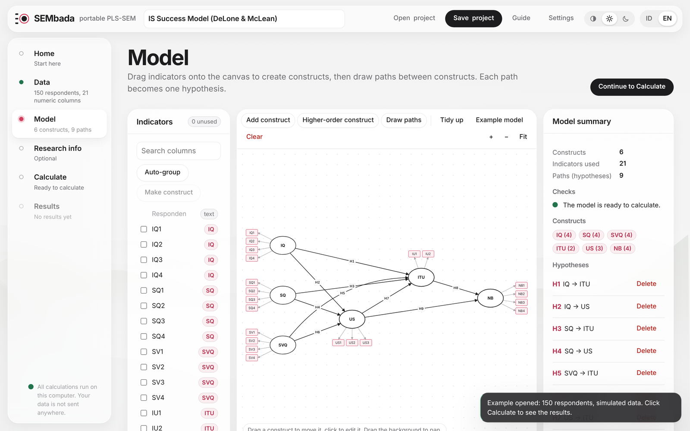
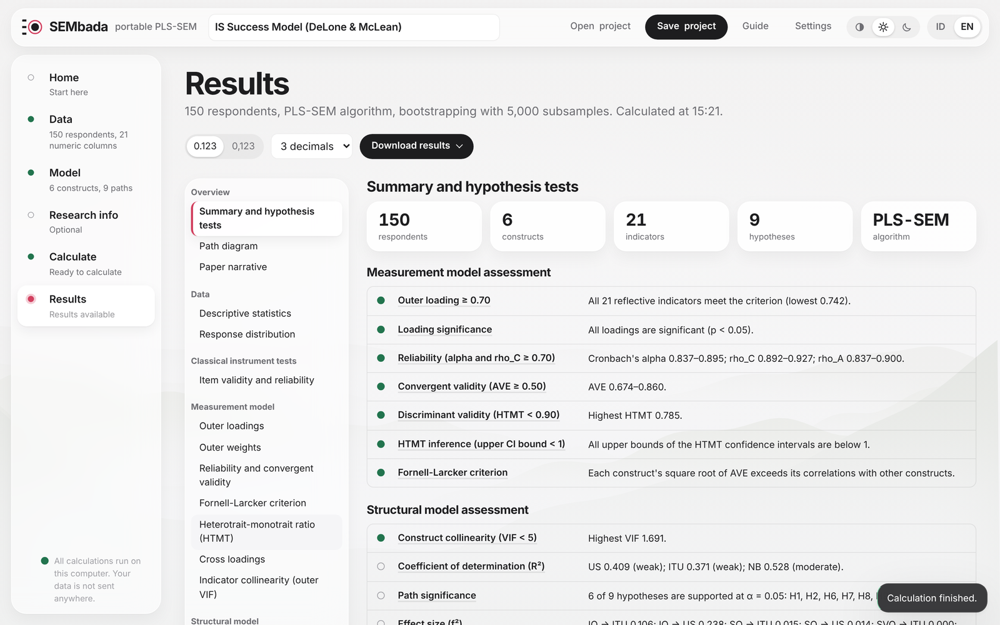
</p>

## The model

A PLS path model has two parts. The **measurement (outer) model** links each construct to its indicators, and the **structural (inner) model** links the constructs to each other.

<p align="center">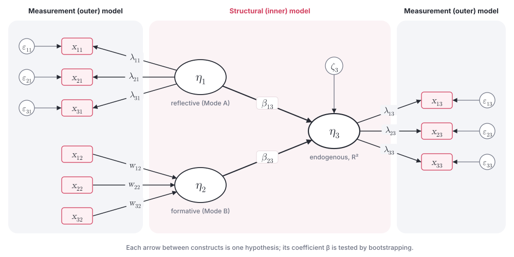</p>

Let $`\eta_j`$ $`(j = 1,\ldots,J)`$ denote the constructs, $`x_{kj}`$ the $`k`$-th indicator of construct $`j`$, and $`P_j`$ the set of constructs with a path into $`\eta_j`$.

**Measurement model.** A reflective construct causes its indicators; a formative construct is a weighted composite of them:

```math
x_{kj} = \lambda_{kj}\,\eta_{j} + \varepsilon_{kj} \qquad\text{(reflective)}, \qquad\qquad \eta_{j} = \sum_{k=1}^{K_j} w_{kj}\,x_{kj} \qquad\text{(formative)}
```

**Structural model.** Each endogenous construct is a linear function of its predecessors plus a disturbance:

```math
\eta_{j} = \sum_{i \in P_{j}} \beta_{ij}\,\eta_{i} + \zeta_{j}
```

Every coefficient $`\beta_{ij}`$ corresponds to one hypothesis.

## Estimation

SEMbada implements the iterative PLS algorithm of Wold and Lohmöller. Indicators are standardized, all outer weights start at 1, and three steps repeat until the weights stop changing.

<p align="center">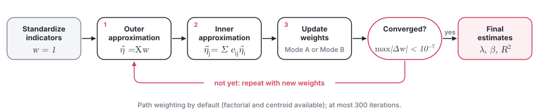</p>

**Steps 1 and 2: outer and inner approximation.** Each construct score is a weighted sum of its standardized indicators, scaled to unit variance, and is then approximated by its neighbours in the path model:

```math
\hat{\eta}_{j} = \sum_{k=1}^{K_{j}} w_{kj}\,x_{kj}, \qquad \tilde{\eta}_{j} = \sum_{i \neq j} e_{ij}\,\hat{\eta}_{i}
```

With the default path weighting scheme, $`e_{ij} = b_{ij}`$ if $`i \in P_j`$ (the regression coefficient of $`\hat\eta_i`$ when $`\hat\eta_j`$ is regressed on its predecessors), $`e_{ij} = \mathrm{cor}(\hat\eta_i,\hat\eta_j)`$ if $`j \in P_i`$, and $`e_{ij} = 0`$ otherwise. The factorial scheme uses the correlation and the centroid scheme its sign, for all adjacent constructs.

**Step 3: weight update.** Reflective constructs use Mode A (correlation weights) and formative constructs Mode B (regression weights). The loop stops when $`\max_k \lvert w_k^{(s+1)} - w_k^{(s)} \rvert < 10^{-7}`$, with at most 300 iterations (both adjustable):

```math
w_{kj} \propto \mathrm{cov}\left(x_{kj},\,\tilde{\eta}_{j}\right) \quad \text{(Mode A)}, \qquad \mathbf{w}_{j} = \left(\mathbf{X}_{j}^{\top}\mathbf{X}_{j}\right)^{-1}\mathbf{X}_{j}^{\top}\tilde{\boldsymbol{\eta}}_{j} \quad \text{(Mode B)}
```

**Final estimates.** Loadings are $`\lambda_{kj} = \mathrm{cor}(x_{kj},\hat\eta_j)`$. The path coefficients of each endogenous construct are least squares estimates on the final scores, $`\hat{\boldsymbol\beta}_{j} = (\hat{\mathbf H}_{P_j}^{\top}\hat{\mathbf H}_{P_j})^{-1}\hat{\mathbf H}_{P_j}^{\top}\hat{\boldsymbol\eta}_{j}`$, where $`\hat{\mathbf H}_{P_j}`$ holds the scores of the predecessors of construct $`j`$.

**Consistent PLS (PLSc).** For reflective constructs, PLSc corrects the attenuation of composite scores with the reliability coefficient $`\rho_A`$ (Dijkstra and Henseler) and then estimates the paths from the corrected construct correlations:

```math
\rho_{A} = \left(\hat{\mathbf{w}}^{\top}\hat{\mathbf{w}}\right)^{2}\frac{\hat{\mathbf{w}}^{\top}\left(\mathbf{S}-\mathrm{diag}\,\mathbf{S}\right)\hat{\mathbf{w}}}{\hat{\mathbf{w}}^{\top}\left(\hat{\mathbf{w}}\hat{\mathbf{w}}^{\top}-\mathrm{diag}(\hat{\mathbf{w}}\hat{\mathbf{w}}^{\top})\right)\hat{\mathbf{w}}}
```

```math
\hat{\boldsymbol\lambda}_{j} = \hat c_{j}\,\hat{\mathbf w}_{j}, \qquad \hat c_{j}^{2} = \frac{\rho_{A,j}}{\left(\hat{\mathbf w}_{j}^{\top}\hat{\mathbf w}_{j}\right)^{2}}, \qquad \widetilde{\mathrm{cor}}(\eta_i,\eta_j) = \frac{\mathrm{cor}(\hat\eta_i,\hat\eta_j)}{\sqrt{\rho_{A,i}\,\rho_{A,j}}}
```

## Assessing the measurement model

**Internal consistency reliability** (for multi-item reflective constructs):

```math
\alpha = \frac{K}{K-1}\left(1 - \frac{\sum_{k=1}^{K}\sigma_{k}^{2}}{\sigma_{t}^{2}}\right)
```

```math
\rho_{C} = \frac{\left(\sum_{k=1}^{K}\lambda_{k}\right)^{2}}{\left(\sum_{k=1}^{K}\lambda_{k}\right)^{2} + \sum_{k=1}^{K}\left(1-\lambda_{k}^{2}\right)}
```

**Convergent validity:**

```math
\mathrm{AVE} = \frac{1}{K}\sum_{k=1}^{K}\lambda_{k}^{2}
```

**Discriminant validity.** The heterotrait–monotrait ratio compares the average correlation between indicators of different constructs, $`\bar r_{ij}`$, with the average correlation among indicators of the same construct, $`\bar r_{ii}`$:

```math
\mathrm{HTMT}_{ij} = \frac{\bar{r}_{ij}}{\sqrt{\bar{r}_{ii}\,\bar{r}_{jj}}}
```

SEMbada also reports bootstrap confidence intervals for HTMT, the Fornell–Larcker criterion $`\sqrt{\mathrm{AVE}_j} > \max_{i\neq j}\lvert\mathrm{cor}(\hat\eta_i,\hat\eta_j)\rvert`$, and cross loadings.

**Collinearity** among formative indicators and among predictors in the structural model, where $`R_k^2`$ is the $`R^2`$ of regressing variable $`k`$ on the others:

```math
\mathrm{VIF}_{k} = \frac{1}{1 - R_{k}^{2}}
```

| Criterion | Guideline used in the results summary |
|---|---|
| Indicator loading | ≥ 0.708 (≥ 0.70 in practice) |
| Cronbach's α, ρ<sub>A</sub>, ρ<sub>C</sub> | 0.70 to 0.95 |
| AVE | ≥ 0.50 |
| HTMT | < 0.90 for conceptually similar constructs, < 0.85 for distinct ones; the upper bootstrap bound should stay below 1 |
| VIF | < 3 ideal, < 5 acceptable |
| f² | 0.02 small, 0.15 medium, 0.35 large |
| R² | 0.25 weak, 0.50 moderate, 0.75 substantial |
| Q²<sub>predict</sub> | > 0 |
| SRMR | < 0.08 |

## Assessing the structural model

**Explained variance and effect size.** $`p_j`$ is the number of predictors of construct $`j`$, and the effect size compares $`R^2`$ with and without one predictor:

```math
R_{j}^{2} = 1 - \frac{\mathrm{Var}(\hat{\zeta}_{j})}{\mathrm{Var}(\hat{\eta}_{j})},\qquad R_{\mathrm{adj}}^{2} = 1 - \left(1 - R_{j}^{2}\right)\frac{n-1}{n-p_{j}-1}
```

```math
f^{2} = \frac{R_{\mathrm{incl}}^{2} - R_{\mathrm{excl}}^{2}}{1 - R_{\mathrm{incl}}^{2}}
```

**Bootstrapping.** SEMbada draws $`B`$ subsamples with replacement (default 5,000, at most 10,000), re-estimates the model on each, and uses the spread of the estimates:

```math
t = \frac{\hat{\beta}}{\mathrm{SE}^{*}}, \qquad \mathrm{SE}^{*} = \sqrt{\frac{1}{B-1}\sum_{b=1}^{B}\left(\hat{\beta}_{b}^{*} - \bar{\beta}^{*}\right)^{2}}
```

```math
p = 2\left[1 - F_{t,\,B-1}\!\left(\lvert t\rvert\right)\right] \qquad\text{(two-tailed)}
```

Percentile intervals take the empirical quantiles of the bootstrap estimates:

```math
\mathrm{CI}_{1-\alpha} = \left[\hat{\beta}^{*}_{(\alpha/2)},\ \hat{\beta}^{*}_{(1-\alpha/2)}\right]
```

Bias-corrected and accelerated (BCa) intervals adjust these quantiles with a bias term $`\hat z_0`$ and a jackknife acceleration $`\hat a`$, where $`\hat\beta_{(i)}`$ is the estimate without observation $`i`$:

```math
\hat z_0 = \Phi^{-1}\!\left(\frac{\#\{\hat\beta^{*}_{b} < \hat\beta\}}{B}\right), \qquad \hat a = \frac{\sum_{i}\left(\bar\beta_{(\cdot)} - \hat\beta_{(i)}\right)^{3}}{6\left[\sum_{i}\left(\bar\beta_{(\cdot)} - \hat\beta_{(i)}\right)^{2}\right]^{3/2}}
```

```math
\alpha_{1} = \Phi\!\left(\hat z_0 + \frac{\hat z_0 + z_{\alpha/2}}{1 - \hat a\,(\hat z_0 + z_{\alpha/2})}\right), \qquad \alpha_{2} = \Phi\!\left(\hat z_0 + \frac{\hat z_0 + z_{1-\alpha/2}}{1 - \hat a\,(\hat z_0 + z_{1-\alpha/2})}\right), \qquad \mathrm{CI}_{\mathrm{BCa}} = \left[\hat\beta^{*}_{(\alpha_1)},\ \hat\beta^{*}_{(\alpha_2)}\right]
```

**Mediation.** A specific indirect effect is the product of the coefficients along its path; total effects collect all direct and indirect effects. With $`\mathbf B`$ the matrix of path coefficients,

```math
\beta_{X \rightarrow M \rightarrow Y} = \beta_{XM}\,\beta_{MY}
```

```math
\mathbf T = \left(\mathbf I - \mathbf B\right)^{-1} - \mathbf I, \qquad \text{indirect effects} = \mathbf T - \mathbf B
```

Every indirect effect gets a bootstrap confidence interval.

**Model fit.** The standardized root mean square residual compares the observed indicator correlations $`r_{ij}`$ with those implied by the model, $`\hat r_{ij}`$:

```math
\mathrm{SRMR} = \sqrt{\frac{2}{p(p+1)}\sum_{i \le j}\left(r_{ij} - \hat{r}_{ij}\right)^{2}}
```

**Predictive power (PLSpredict).** Using $`k`$-fold cross-validation repeated several times, each indicator of the endogenous constructs is predicted for cases that were left out of estimation, and compared with the training mean and with a linear regression benchmark:

```math
Q_{\mathrm{predict}}^{2} = 1 - \frac{\sum_{i}\left(y_{i} - \hat{y}_{i}\right)^{2}}{\sum_{i}\left(y_{i} - \bar{y}_{\mathrm{train}}\right)^{2}}
```

```math
\mathrm{RMSE} = \sqrt{\frac{1}{N}\sum_{i=1}^{N}\left(y_{i} - \hat{y}_{i}\right)^{2}},\qquad \mathrm{MAE} = \frac{1}{N}\sum_{i=1}^{N}\left|y_{i} - \hat{y}_{i}\right|
```

Lower prediction errors (RMSE or MAE) than the linear benchmark for most indicators indicate medium to high predictive power.

## Advanced analyses

**Moderation (two-stage approach).** Stage 1 estimates the model without the interaction and saves the construct scores. Stage 2 adds the product of the standardized scores as a new predictor:

```math
\eta_{X \times M} = \hat{\eta}_{X}\,\hat{\eta}_{M}
```

The effect of $`X`$ on $`Y`$ then depends on the moderator. SEMbada plots simple slopes at $`M = -1`$, $`0`$, and $`+1`$ standard deviation:

```math
\frac{\partial \eta_{Y}}{\partial \eta_{X}} = \beta_{XY} + \beta_{(X \times M)Y}\,\eta_{M}
```

**Higher-order constructs (disjoint two-stage approach).** Stage 1 estimates the lower-order constructs; stage 2 uses their scores as the indicators of the higher-order construct $`\xi_H`$, which then replaces them in the structural model:

```math
\hat{\eta}_{l} = \lambda_{l}\,\xi_{H} + \varepsilon_{l}, \quad l = 1, \ldots, L
```

**Multigroup analysis (MGA).** Before comparing groups, SEMbada runs MICOM. Step 2 (compositional invariance) correlates the composite scores formed with the weights of each group,

```math
c_{j} = \mathrm{cor}\left(\mathbf{X}\mathbf{w}_{j}^{(1)},\, \mathbf{X}\mathbf{w}_{j}^{(2)}\right)
```

and compares $`c_j`$ with its permutation distribution. Step 3 tests the equality of composite means and variances. Path differences $`\Delta\beta = \beta^{(1)} - \beta^{(2)}`$ are tested with $`P`$ random reassignments of cases to groups,

```math
p = \frac{\#\left\{\lvert\Delta\beta^{*}\rvert \geq \lvert\Delta\beta\rvert\right\} + 1}{P + 1}
```

together with the parametric and Welch–Satterthwaite tests based on group-wise bootstrapping.

**Importance–performance map analysis (IPMA).** Indicators are rescaled to 0–100 and weights are unstandardized and normalized within each construct:

```math
\tilde{w}_{kj} = \frac{w_{kj}/s_{k}}{\sum_{l \in B_{j}} w_{lj}/s_{l}}
```

```math
\mathrm{Perf}_{j} = \frac{1}{n}\sum_{i=1}^{n}\sum_{k \in B_{j}} \tilde{w}_{kj}\,\frac{x_{ik} - \min_{k}}{\max_{k} - \min_{k}} \times 100
```

The importance of construct $`j`$ for the target construct $`t`$ is its unstandardized total effect:

```math
\mathrm{Imp}_{j} = \left[\left(\mathbf{I} - \tilde{\mathbf{B}}\right)^{-1} - \mathbf{I}\right]_{jt}
```

**Minimum sample size (inverse square root method).** For a significance level of 5% and a power of 80%,

```math
n_{\min} > \left(\frac{2.486}{\lvert\beta_{\min}\rvert}\right)^{2}
```

where $`\beta_{\min}`$ is the smallest absolute path coefficient expected to be significant. SEMbada uses the smallest significant path in your results, or the smallest path when none is significant.

## Figures and the path diagram

The path diagram is drawn by SEMbada itself and can be edited directly in the results: drag constructs and number labels, click a construct to move its indicators, or click a path to make it straight or curved. Positions are saved with the project and used in every export.

<p align="center">
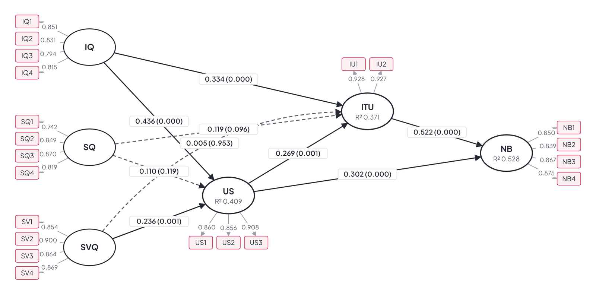
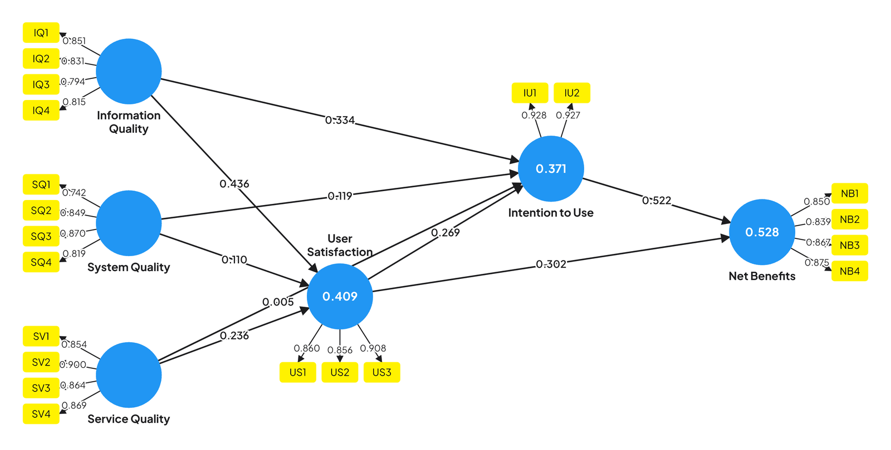
</p>

The **Customize** panel offers four ready-made styles (SEMbada, blue circles, black and white for journals, minimal) and fine control over construct shape, full or abbreviated names, how R² is shown, indicators and loadings, framed or plain labels, significance stars, dashed non-significant paths, straight, automatic, or curved lines (with adjustable curvature), colours, text size, line width, and PNG resolution or transparency.

<p align="center">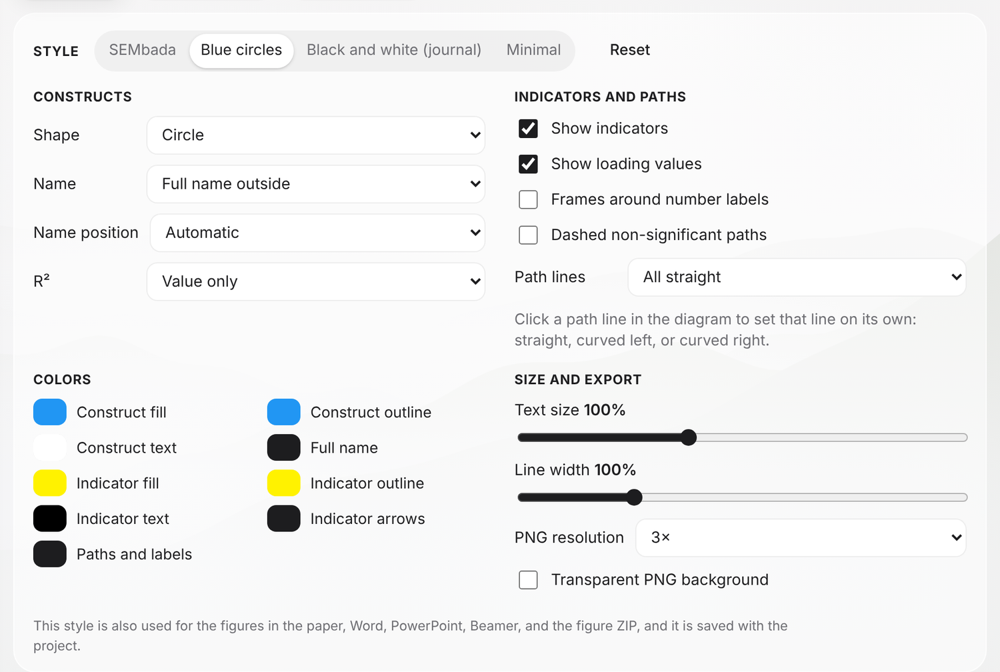</p>

Every results section has its own chart, available in the app and as PNG or SVG:

| | |
|---|---|
| 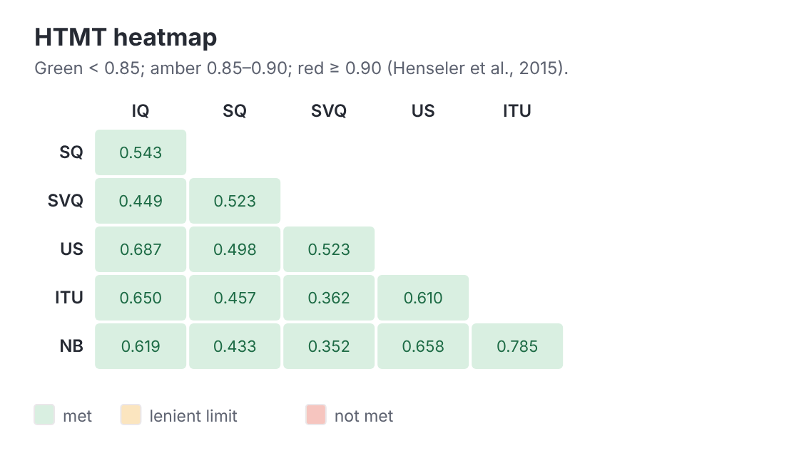 | 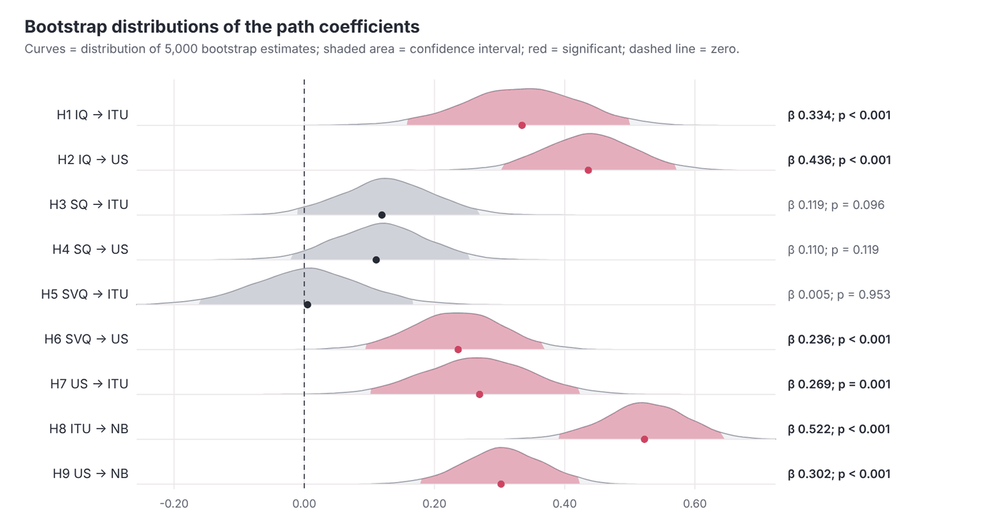 |
| 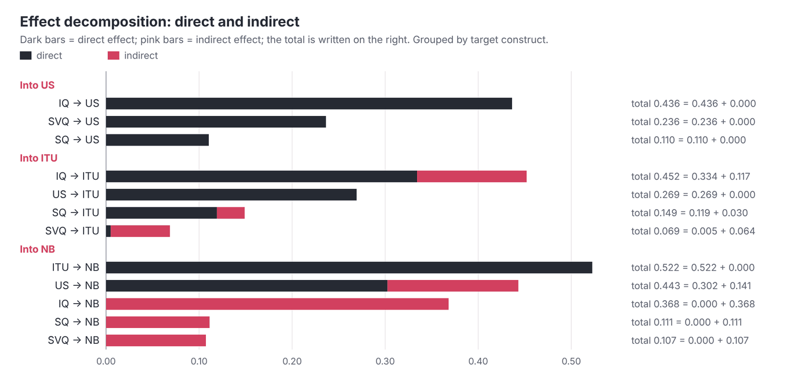 | 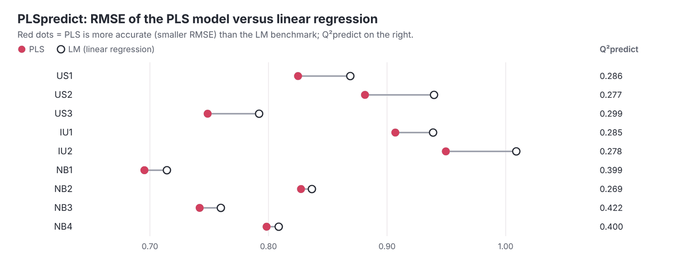 |
| 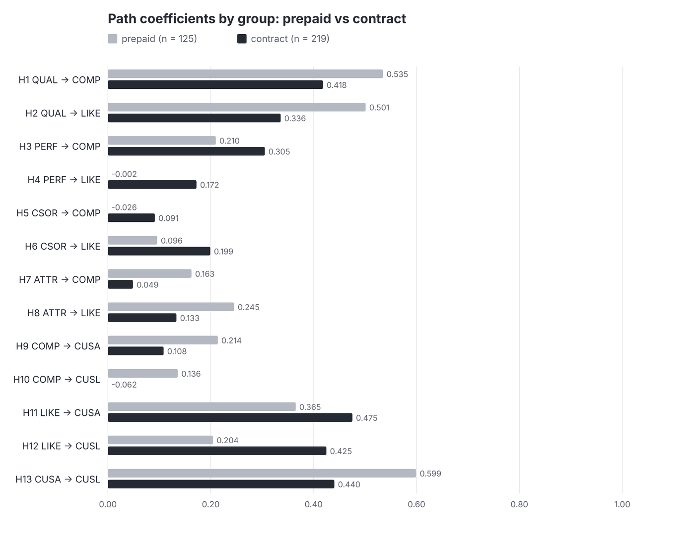 | 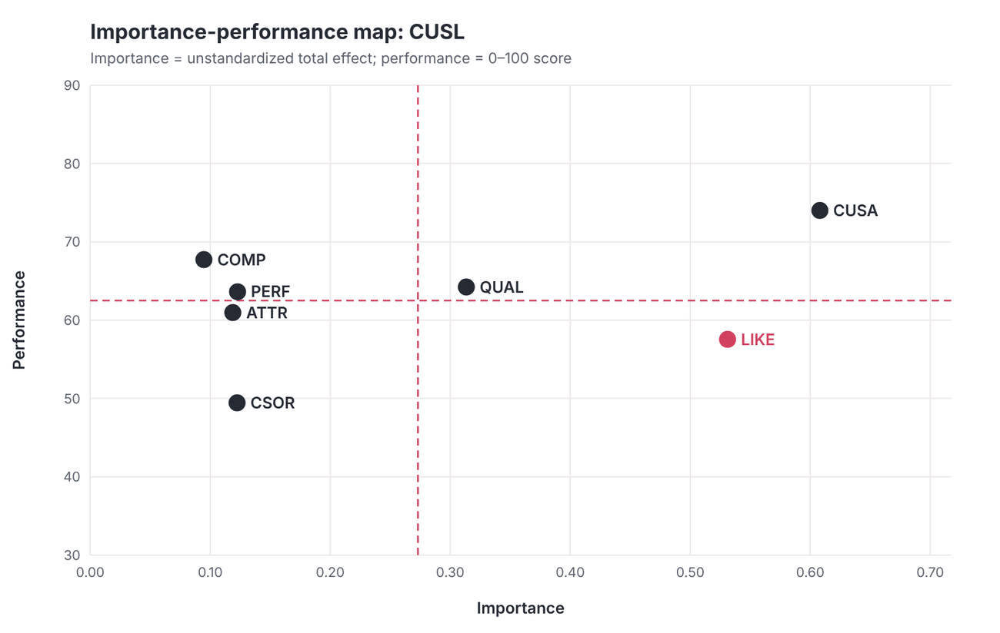 |

## Exports

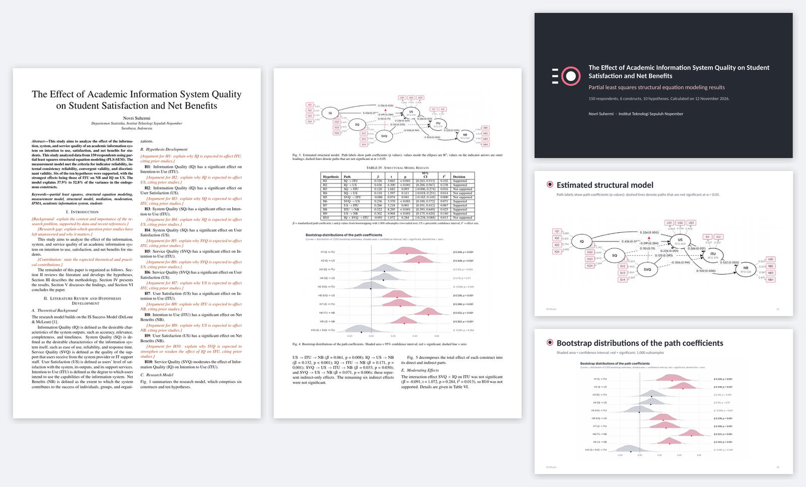

| Format | Contents |
|---|---|
| Word report (.docx) | All results tables with notes and interpretation |
| Paper (Word, LaTeX, or PDF) | Two-column conference-style manuscript: introduction, hypotheses, method, results, discussion, and an appendix with the estimation formulas. Placeholders mark the parts only the author can write. The PDF is compiled inside the app with an embedded LaTeX engine |
| Slides (PowerPoint or Beamer) | Method, measurement model, structural model, and advanced analyses, with equations typeset in LaTeX |
| Excel (.xlsx) | Every results table on its own sheet |
| Figures (.zip) | All charts and path diagrams as PNG and SVG |
| Project (.sembada.json) | Data, model, settings, and diagram layout, to reopen later |
| R code | The equivalent seminr script: shown in the results with a copy button, appended to the Word report, and included in the Excel workbook |

Documents can be produced in English or Indonesian, independently of the interface language.

## Validation against R

The PLS engine was compared with the R package **seminr** on the bundled datasets. Outer weights, loadings, path coefficients, R², reliability coefficients, HTMT, and effect sizes agree to numerical precision; consistent PLS and several datasets were also checked against **cSEM**. Bootstrapping and PLSpredict draw random subsamples: with a fixed seed SEMbada always reproduces its own results, but its random-number generator differs from R's, so resampling-based statistics can differ in the third decimal. The advanced analyses (two-stage moderation, disjoint two-stage higher-order constructs, IPMA, and MGA with MICOM) were cross-checked with an independent implementation, with differences below 10<sup>−10</sup>.

## Example datasets

All examples are built into the app (home screen, *Open example*) and are also available as CSV files in [`data/examples`](data/examples). Sources and licences are listed in [`data/README.md`](data/README.md).

| File | Model | n | Data |
|---|---|---|---|
| contoh_delone_mclean_simulasi.csv | IS success (DeLone & McLean) | 150 | simulated |
| contoh_tam_simulasi.csv | Technology acceptance model | 240 | simulated |
| contoh_utaut2_simulasi.csv | UTAUT2 | 320 | simulated |
| contoh_tpb_simulasi.csv | Theory of planned behavior | 260 | simulated |
| contoh_servqual_simulasi.csv | Service quality, satisfaction, and loyalty | 300 | simulated |
| ecsi_mobile_phone.csv | ACSI / ECSI customer satisfaction | 250 | real |
| corporate_reputation.csv | Corporate reputation | 344 | real |
| bank_satisfaction_gender.csv | Bank customer satisfaction | 250 | real |
| influencer_marketing.csv | Influencer marketing (moderation) | 222 | real |
| brand_equity_yoo2000.csv | Marketing mix and brand equity (higher-order) | 569 | simulated from published correlations |
| privacy_location_tracker.csv | Privacy concerns and adoption (mediation) | 1,090 | real |

## Privacy

SEMbada has no server. All computation happens in your browser or desktop app, and your data never leaves your device. When the app is opened from a web address, it is cached so that it keeps working without an internet connection.

## Repository layout and building from source

```
app/      SEMbada_PLS-SEM.html, the complete app in one file (open it in a browser)
src/      application source: PLS engine, user interface, exporters
data/     bundled example datasets (samples.json) and CSV copies
eq/       equations rendered for the app, Word, and slides
fonts/    Plus Jakarta Sans and Inter (SIL Open Font License)
vendor/   docx, PptxGenJS, and the SwiftLaTeX engine, with their licences
docs/img/ illustrations used in this README
tools/    how the example datasets were prepared
build.py  builds app/SEMbada_PLS-SEM.html from the sources
```

To rebuild the app you only need Python 3.9 or newer:

```bash
python3 build.py
```

The result, `app/SEMbada_PLS-SEM.html`, is identical to the file published here. The same file can be hosted as a static page (for example on Posit Connect, GitHub Pages, or any web server) or wrapped as a desktop app.

## Citation

If SEMbada helps your research, please cite it. GitHub shows the details under **Cite this repository**; the app also writes the reference into every generated paper.

> Suhermi, N. (2026). *SEMbada: Portable PLS-SEM software* (Version 1.11.1) [Computer software]. https://github.com/novrisuhermi/sembada

```bibtex
@software{suhermi2026sembada,
  author  = {Suhermi, Novri},
  title   = {SEMbada: Portable PLS-SEM software},
  version = {1.11.1},
  year    = {2026},
  url     = {https://github.com/novrisuhermi/sembada}
}
```

## References

- Becker, J.-M., Klein, K., & Wetzels, M. (2012). Hierarchical latent variable models in PLS-SEM: Guidelines for using reflective-formative type models. *Long Range Planning, 45*(5–6), 359–394.
- Dijkstra, T. K., & Henseler, J. (2015). Consistent partial least squares path modeling. *MIS Quarterly, 39*(2), 297–316.
- Efron, B. (1987). Better bootstrap confidence intervals. *Journal of the American Statistical Association, 82*(397), 171–185.
- Fornell, C., & Larcker, D. F. (1981). Evaluating structural equation models with unobservable variables and measurement error. *Journal of Marketing Research, 18*(1), 39–50.
- Hair, J. F., Hult, G. T. M., Ringle, C. M., & Sarstedt, M. (2022). *A primer on partial least squares structural equation modeling (PLS-SEM)* (3rd ed.). Sage.
- Hair, J. F., Hult, G. T. M., Ringle, C. M., Sarstedt, M., Danks, N. P., & Ray, S. (2021). *Partial least squares structural equation modeling (PLS-SEM) using R: A workbook*. Springer.
- Henseler, J., & Chin, W. W. (2010). A comparison of approaches for the analysis of interaction effects between latent variables using partial least squares path modeling. *Structural Equation Modeling, 17*(1), 82–109.
- Henseler, J., Ringle, C. M., & Sarstedt, M. (2015). A new criterion for assessing discriminant validity in variance-based structural equation modeling. *Journal of the Academy of Marketing Science, 43*(1), 115–135.
- Henseler, J., Ringle, C. M., & Sarstedt, M. (2016). Testing measurement invariance of composites using partial least squares. *International Marketing Review, 33*(3), 405–431.
- Hu, L., & Bentler, P. M. (1999). Cutoff criteria for fit indexes in covariance structure analysis: Conventional criteria versus new alternatives. *Structural Equation Modeling, 6*(1), 1–55.
- Kock, N., & Hadaya, P. (2018). Minimum sample size estimation in PLS-SEM: The inverse square root and gamma-exponential methods. *Information Systems Journal, 28*(1), 227–261.
- Lohmöller, J.-B. (1989). *Latent variable path modeling with partial least squares*. Physica.
- Rademaker, M. E., & Schuberth, F. *cSEM: Composite-based structural equation modeling* [R package]. https://CRAN.R-project.org/package=cSEM
- Ray, S., Danks, N. P., & Calero Valdez, A. *seminr: Building and estimating structural equation models* [R package]. https://CRAN.R-project.org/package=seminr
- Ringle, C. M., & Sarstedt, M. (2016). Gain more insight from your PLS-SEM results: The importance-performance map analysis. *Industrial Management & Data Systems, 116*(9), 1865–1886.
- Sarstedt, M., Henseler, J., & Ringle, C. M. (2011). Multigroup analysis in partial least squares (PLS) path modeling: Alternative methods and empirical results. *Advances in International Marketing, 22*, 195–218.
- Shmueli, G., Sarstedt, M., Hair, J. F., Cheah, J.-H., Ting, H., Vaithilingam, S., & Ringle, C. M. (2019). Predictive model assessment in PLS-SEM: Guidelines for using PLSpredict. *European Journal of Marketing, 53*(11), 2322–2347.
- Tenenhaus, M., Esposito Vinzi, V., Chatelin, Y.-M., & Lauro, C. (2005). PLS path modeling. *Computational Statistics & Data Analysis, 48*(1), 159–205.
- Wold, H. (1982). Soft modeling: The basic design and some extensions. In K. G. Jöreskog & H. Wold (Eds.), *Systems under indirect observation, Part II* (pp. 1–54). North-Holland.

## Third-party software and licences

SEMbada bundles docx (MIT), PptxGenJS (MIT), JSZip (MIT), the SwiftLaTeX pdfTeX engine (AGPL-3.0) with TeX Live components under their own free licences, and the Plus Jakarta Sans and Inter typefaces (SIL Open Font License 1.1). Desktop builds use Neutralinojs (MIT). The real example datasets come from the R packages seminr, cSEM, and plspm (GPL-3). Details are in [`THIRD_PARTY_NOTICES.md`](THIRD_PARTY_NOTICES.md) and in the app under *Guide → About*.

<p align="center"><sub>SEMbada is developed by Novri Suhermi, Institut Teknologi Sepuluh Nopember, Surabaya, Indonesia.</sub></p>
